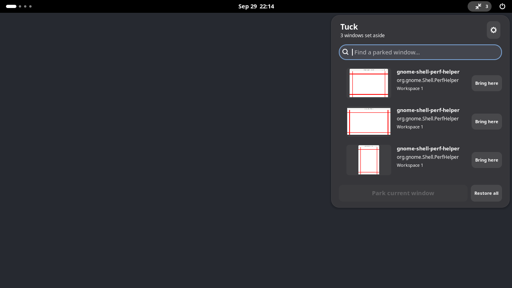

# Tuck

A little room to focus. Park a window for later, then find it in a small shelf in the top panel.

Tuck collects only windows you explicitly park. Each entry shows a thumbnail, title, application, and workspace. Click the entry to restore it on its existing workspace, or choose **Bring here** to move it to your current one.



## Use

| Action | Default shortcut |
| --- | --- |
| Park the focused window | Super + Ctrl + H |
| Open the shelf | Super + Ctrl + Space |
| Restore the first search result | Enter |
| Move from search into the results | Down |
| Navigate controls | Tab / Shift + Tab |
| Dismiss the shelf | Escape |

The panel menu also has **Park current window**, **Restore all**, and a preferences button. Preferences let you change or clear both shortcuts and turn thumbnails off.

Normal minimizing, Overview, and Alt-Tab keep working. Restoring a parked window elsewhere removes it from Tuck. Closing an application removes its entry. Turning the extension off reveals its remaining parked windows without changing their workspaces or focusing them. No windows, titles, or screenshots are saved to disk.

Thumbnails use compositor clones while the popup is open. Minimized applications may pause drawing. Tuck does not promise continuously updating video previews.

## Install on GNOME 51

Download the ZIP from the [v0.1.0 prerelease](https://github.com/SoulSniper-V2/tuck/releases/tag/v0.1.0). This is an early version; feedback and issue reports are welcome.

The initial supported version is **GNOME Shell 51**. Do not edit the version list to bypass compatibility checking.

Install the packaged ZIP on the GNOME machine:

```sh
gnome-extensions install --force tuck-v0.1.0.shell-extension.zip
```

Log out and back in so Shell discovers the newly installed extension, then:

```sh
gnome-extensions enable tuck@tuck-extension
gnome-extensions prefs tuck@tuck-extension
```

If you installed an earlier build of this prerelease, disable and uninstall that copy in GNOME Extensions first: the extension ID has changed.

You can also enable it through GNOME Extensions or Extension Manager. If a default shortcut is already in use, change it in Tuck's preferences. Preferences detect collisions between Tuck's own actions; they cannot comprehensively detect shortcuts registered by other extensions.

## Build and check

Runtime: GJS, GNOME Shell 51, GTK 4, and libadwaita. No npm packages, companion application, subprocesses, network requests, prototype patches, or background polling run in the installed extension.

Developer tooling: Node 24 or later, Python 3, and `glib-compile-schemas` for packaging.

```sh
npm ci
npm run check
npm run pack
```

The package is written to `dist/tuck-v0.1.0.shell-extension.zip`. Its explicit file list excludes tests, documentation, npm dependencies, and development configuration.

For native tests in an isolated GNOME 51 session, see [verification](docs/verification.md). Unit checks alone do not prove Shell integration. Hosted lint, unit, schema, and package checks are available in [GitHub Actions](https://github.com/SoulSniper-V2/tuck/actions). Native GNOME tests are recorded separately.

## Limitations

- Parking is session-only. It does not survive logout or Shell restart.
- Only normal, minimizable application windows are eligible; dialogs and transient windows are excluded.
- Restore uses the window's current workspace, including changes made after parking.
- Other Shell versions, extension combinations, screen readers, and physical multi-monitor configurations require additional testing.
- This prerelease has not been submitted to extensions.gnome.org.

GPL-3.0-or-later. See [LICENSE](LICENSE).
